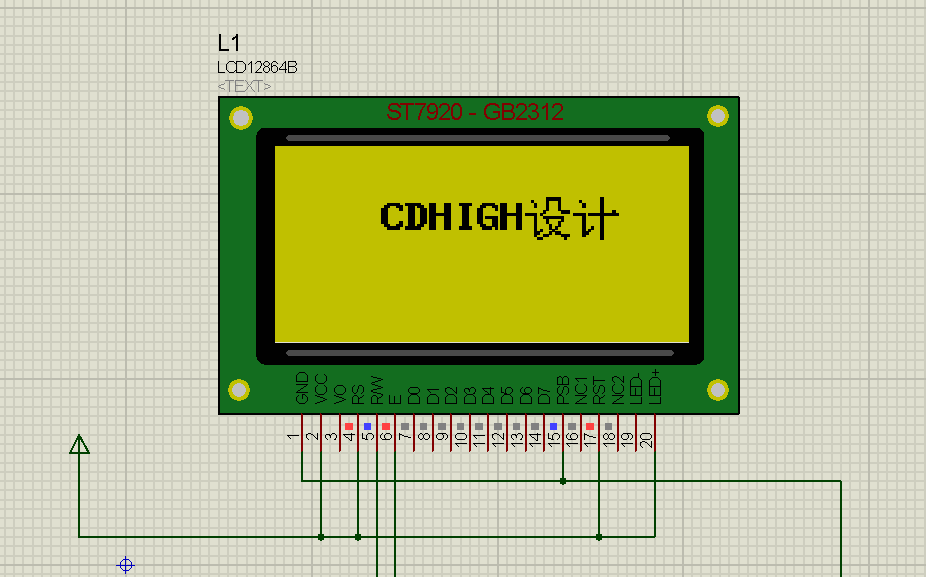
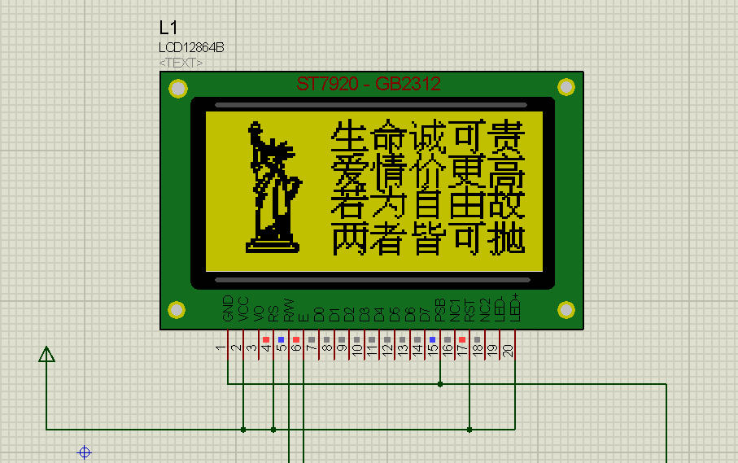
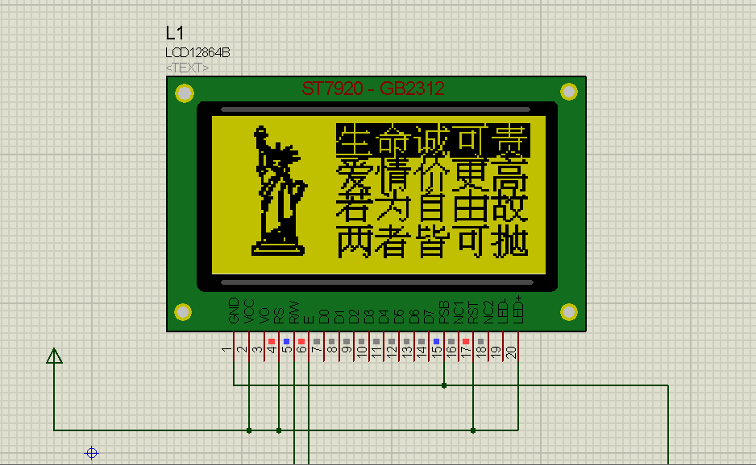
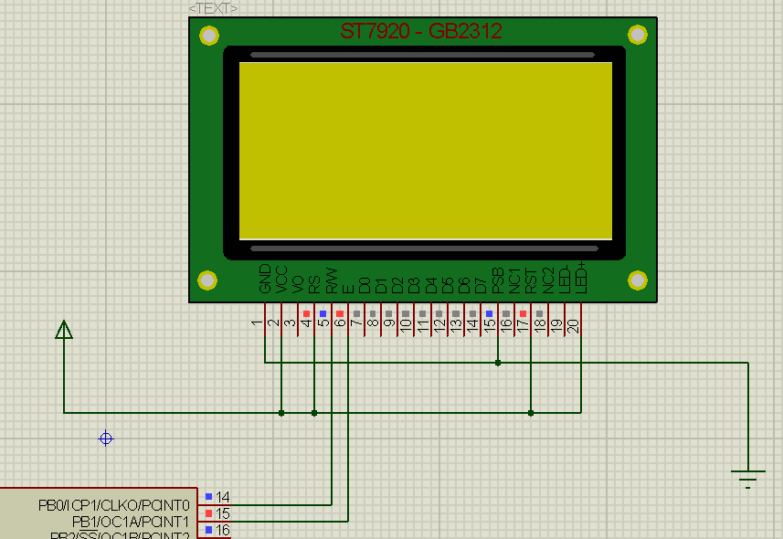

## Proteus VSM simulation model of LCD12864 module based on ST7920

## Features  
* Supported interfaces: parallel 8-bit read and write, parallel 4-bit read and write, serial write  
* Supported characters: Chinese characters(GB2312), numbers, ascii letters (CGROM/HCGROM/DDRAM)  
* Support drawing and custom characters (GDRAM/CGRAM)  
* Supports integrating text and graphics, the pixels that overlap the image and text are displayed using the XOR method  

## Usage  
* Copy release/MODELS/LCD12864B.DLL to the MODELS directory of proteus
* Copy the files in release/LIBRARY to the LIBRARY directory of proteus
* Search 12864B in proteus to find this device

### Proteus version compatibility  
* **Proteus 8.x**: use release/MODELS/LCD12864B.DLL (32-bit). Confirmed working on 8.1 and 8.9.
* **Proteus 9.x**: Proteus 9.0 is a 64-bit application and cannot load 32-bit model DLLs. Build a 64-bit DLL yourself:
  1. Open LCD12864B_SRC/LCD12864B.sln with VS (2012 or later), build the Release|x64 configuration;
  2. Keep the output name as LCD12864B.DLL (the MDF references the DLL by this name);
  3. Copy it to the MODELS directory of Proteus 9. The LIBRARY files are shared with 8.x.

## File description  
* Open test/test7920.pdsprj in proteus 8.1 (and above) to show demo.
* 12864B.pdsprj is a model prototype, been used to create a displayable PROTEUS VSM model.
* The source code is located in the LCD12864B_SRC directory, compiled with VS2010 and above.

## Known bugs or tips  
* Can't display properly on some PROTEUS versions (such as 8.6), what you can do is to move the upper left corner of LCD12864B display area to the coordinate origin of the schematic diagram.
Some versions can display normally at any position (such as 8.1 and 8.9). the reason is unknown, a pull request is welcomed if you can solve it.
A user also reported the model does not work on 8.8; if you hit this, try the workaround above first, and please report the exact symptom (blank display / wrong position / error message) in an issue if it differs.
* A single ASCII character is displayed immediately after being written (same as real hardware). When integrating Chinese characters and ASCII, note that the number of consecutive ASCII characters must be an even number. If it is not an even number, please add a space after it. This is a design limitation of ST7920: each DDRAM address is a 16-bit display unit, Chinese character codes can only start at the unit boundary, and the address counter (AC) advances only after the second byte of the unit is written.
* GB2312 Chinese characters are supported currently. If BIG5 encoding is required, please help to create a dot matrix of BIG5 characters.  
  Description (refers to gb2312.h):  
  1. Font size: 16x16.  
  2. Scan horizontally, high bit first, each Chinese character 32 bytes.  
  3. Generate font index table, every two bytes for a Chinese character internal code.  

## License  
* GPLV3
